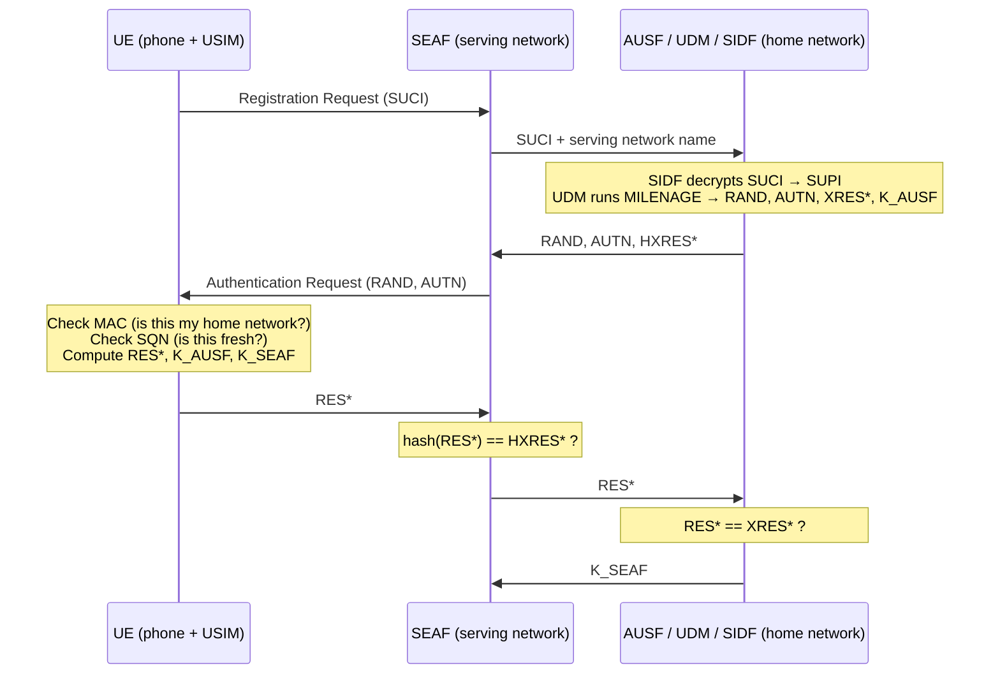

# 5G Auth Toolkit


A from-scratch Python implementation of the cryptography a phone and a mobile network use to recognise each other in 5G, plus a simulator that runs the full registration flow and lets you attack it.

- **MILENAGE** (3GPP TS 35.206): the f1 to f5* functions that run on every SIM card
- **SUCI concealment** with ECIES Profile B (TS 33.501 Annex C): how a 5G phone hides its permanent identity from IMSI catchers
- **5G-AKA** (TS 33.501 §6.1.3.2): mutual authentication and the key hierarchy CK/IK → K<sub>AUSF</sub> → K<sub>SEAF</sub>
- **Attack scenarios**: replay, fake base station, SUCI tampering and a rogue serving network, each blocked by a specific mechanism

Every primitive is checked against the official 3GPP test vectors.

## Quick start

```bash
git clone https://github.com/BaboucarrKah/5G-Auth-Toolkit.git
cd 5g-auth-toolkit
python -m venv .venv
source .venv/bin/activate          # Windows: .venv\Scripts\activate
pip install -e ".[dev]"

5g-auth simulate
pytest
```

```
Subscriber imsi-242010123456789

    UE | sending suci-0-242-01-0000-2-1-02b5644c...fee5080caeb94615d57c47ff13
  SIDF | SUCI resolved to imsi-242010123456789
  AUSF | auth vector generated (SQN=1)
  SEAF | auth request to UE, SNN=5G:mnc001.mcc242.3gppnetwork.org
    UE | verifying AUTN
    UE | network OK, SQN=1, sending RES*
  SEAF | HRES* OK, asking AUSF to confirm
  AUSF | RES* matches XRES*, KSEAF released
  SEAF | registration complete, KSEAF=6d2c8508037a54b0...
```

## The flow



## Attacks

```bash
5g-auth simulate --attack replay
```

| Scenario | What the attacker does | What stops it |
|---|---|---|
| `replay` | Records a valid RAND/AUTN and sends it again | UE rejects the old sequence number (`SYNCH_FAILURE`) |
| `fake-network` | Fake base station without the subscriber key sends its own challenge | MAC in AUTN can't be forged without K (`MAC_FAILURE`) |
| `tamper-suci` | Flips a bit in the encrypted identity | HMAC tag in the SUCI fails (`SUCI_INVALID`) |
| `wrong-network` | Rogue network reuses a challenge meant for another network | RES* is bound to the serving network name, so the home network rejects it (`RES_MISMATCH`) |

 For what each attack looks like in the logs, and the break-it tests that show the test suite catches real bugs, see [docs/SECURITY_TESTS.md](docs/SECURITY_TESTS.md).

## Security monitoring

Blocking an attack isn't the same as noticing it. The home network can log every login and every failure as a JSON event, ready for a SIEM:

```json
{"time": "2026-11-01T12:08:07.292+00:00", "event_type": "auth_failure", "subscriber": "4fc86ba71c2ffb4a",
 "cell": "cell-07", "serving_network": "5G:mnc001.mcc242.3gppnetwork.org", "cause": "MAC_FAILURE"}
```

The subscriber is logged as an HMAC-SHA256 pseudonym of the SUPI, never the real identity. Failures the phone detects (a forged MAC or an old SQN) are reported back by the serving network, so they reach the logs too.

The companion project **[5g-detection-lab](https://github.com/BaboucarrKah/5g-detection-lab)** uses this to generate an hour of realistic traffic with four hidden attacks, and finds all four in Splunk with detection rules mapped to MITRE FiGHT.

## Design notes

- **SUCI is unlinkable.** A fresh ephemeral key per SUCI means two registrations by the same person look unrelated on the air interface. There's a test for that.
- **The serving network never sees XRES\* or K<sub>AUSF</sub>.** It only gets a hash, so a compromised or roaming partner network can't complete authentication on its own.
- **SQN is masked with AK** so the counter itself can't be used to track a subscriber.
- **Constant-time comparisons** (`hmac.compare_digest`) for every MAC and response check.
- **Encrypt-then-MAC** in SUCI: the tag is verified before anything is decrypted.

## Project layout

```
src/fiveg_auth/
  milenage.py   f1–f5* (TS 35.206)
  suci.py       ECIES Profile B conceal / deconceal (TS 33.501 Annex C)
  aka.py        5G-AKA, RES*, HXRES*, key derivation (TS 33.501 Annex A)
  network.py    UE, serving network and home network models
  events.py     JSON security events with pseudonymised subscribers
  cli.py        simulator and attack scenarios
tests/          conformance vectors + security property tests
```

## Test vectors

| Component | Source | Status |
|---|---|---|
| MILENAGE | TS 35.208 test set 1 (all 7 outputs + OPc) | ✅ |
| SUCI Profile B | TS 33.501 Annex C.4 | ✅ |
| 5G-AKA | Round-trip and negative tests | ✅ |

## Limitations

This is a learning and demonstration tool, not production code. It doesn't implement resynchronisation (AUTS), SQN windowing with IND bits, Profile A (X25519), NAS messaging or real network transport. Keys are generated in memory and never persisted.

## Roadmap

- [ ] Run UE, SEAF and home network as separate processes over sockets
- [x] Structured JSON logging and detection rules for a SIEM (see [5g-detection-lab](https://github.com/BaboucarrKah/5g-detection-lab))
- [ ] Store the home network private key in a cloud KMS / HSM
- [ ] AUTS resynchronisation and Profile A

## References

- 3GPP TS 35.206 / 35.208: MILENAGE specification and test data
- 3GPP TS 33.501: Security architecture and procedures for 5G System
- 3GPP TS 33.220 Annex B: Generic key derivation function
- 3GPP TS 23.003: Numbering, addressing and identification

## License

MIT
