# Build log: MILENAGE, SUCI and 5G-AKA

Oct 23, 2026 · BK

## What is MILENAGE, SUCI and 5G-AKA?

Every time your phone connects to a mobile network, the phone and the network have to answer two questions: are you who you say you are, and how do we keep this connection private? In 5G this is solved with three pieces, and this project implements all of them.

- **MILENAGE** is the maths inside the SIM card. The SIM and your operator both know the same secret key (K). From that key and a random number, they can each calculate the same answers without ever sending the key itself.
- **SUCI** hides who you are. Older networks often sent your permanent ID (IMSI) in clear text, and fake base stations called IMSI catchers used that to track people. In 5G the phone encrypts its ID with the operator's public key before sending it, so only the real home network can read it.
- **5G-AKA** is the actual login. The network sends a challenge, the phone checks that the challenge really came from its own operator, and then answers. If both sides are happy, they end up with the same session key, again without sending it.

There are three parties in the logs further down. **UE** is the phone. **SEAF** is the network you're connected to right now, which can be another operator if you're abroad. **AUSF/SIDF** is your own operator (the home network), which is the only one that knows your secret key.

## Status

Everything works so far. The project installs and runs on my Windows PC, all 30 automated tests pass, and every attack I've tried so far gets stopped by the check that's supposed to stop it. This is my working log, so I'm adding to it as I go. It's not the final documentation yet, and there are more tests I want to do (listed at the bottom).

The project started from two assignments in applied cryptography, where I implemented MILENAGE and a simplified version of SUCI. I wanted to take it further, so I rebuilt both to follow the actual 3GPP standards and added the 5G-AKA protocol on top. I also made a small simulator that runs a full 5G login between a phone and the network, and lets me attack it to see what happens.

| Check | Result |
| --- | --- |
| Environment setup (venv + install) | Done |
| Test suite, `pytest -v` | 30 / 30 passed |
| Normal registration, `5g-auth simulate` | Completed, UE and network share the same KSEAF |
| Attack scenarios (4) | 4 / 4 blocked |
| Break-it tests (change code on purpose) | 3 of 3 done (replay check, MILENAGE and SUCI test vectors) |
| GitHub repo + CI | Public repo, CI green on both pushes |

## Environment setup

I set everything up in VS Code on Windows with Python 3.14.7. I used a virtual environment, which is basically a separate box for this project's Python packages. That way nothing I install here messes with other projects on my PC, and anyone else can get the exact same setup by running the same commands.

1. I opened the `5g-auth-toolkit` folder in VS Code. It started in Restricted Mode, which is a safety feature for code you just downloaded. Since this is my own code, I trusted the folder so the Python extension and the test panel could work.
2. I created the environment with `python -m venv .venv`. VS Code noticed it and asked if it should use it for this folder, and I said yes. That makes the editor use the right Python and understand the imports.
3. I activated it with `.venv\Scripts\activate`. You can see it's active when the terminal line starts with `(.venv)`.
4. I installed the project with `pip install -e ".[dev]"`. This installs my code plus the tools it needs: cryptography (the library that does AES and elliptic curves), pytest (runs the tests) and ruff (checks code style). The `-e` means changes I make to the code work right away without reinstalling.

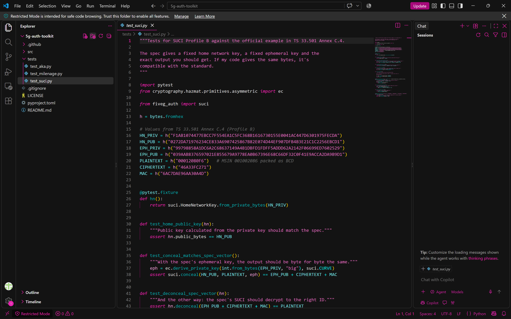

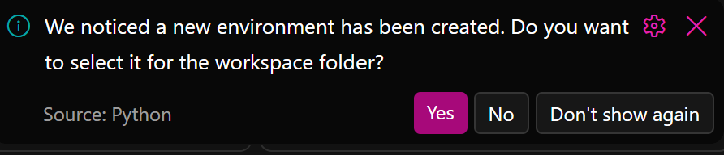

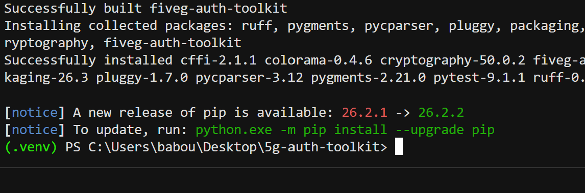

## Test suite

I ran `pytest -v` and all 30 tests passed in 0.65 seconds.

The tests do two different jobs. Some check that my code is **correct**: 3GPP publishes official test vectors, which are fixed inputs together with the exact output you're supposed to get. If my code gives the same bytes, I know it follows the standard and isn't just working by accident. The rest check that the code is **secure**: they try things an attacker would do, like changing one bit or replaying an old message, and make sure the code refuses.

| File | Tests | What it proves |
| --- | --- | --- |
| `test_aka.py` | 11 | Full 5G-AKA round trip, serving network never gets XRES\* or KAUSF, forged AUTN, replay, AMF separation bit, keys bound to network name, end-to-end registration, unknown subscriber, SUCI for wrong home network |
| `test_milenage.py` | 7 | OPc and all seven outputs (f1 to f5\*) match TS 35.208 test set 1, shortcut matches single functions, bad key and RAND lengths refused |
| `test_suci.py` | 12 | Output matches TS 33.501 Annex C.4 byte for byte, round trip, same ID gives different SUCIs, tampering in key, ciphertext or tag caught, wrong home key and truncated input refused, BCD packing |

In the first run, two test names in `test_milenage.py` showed up as long rows of raw bytes, because pytest names each version of a test after its inputs. I fixed it by adding `ids=["short K", "long opc"]` to the `parametrize` line, so they now show as `test_rejects_bad_key_lengths[short K]` and `[long opc]`. Still 30 passed.

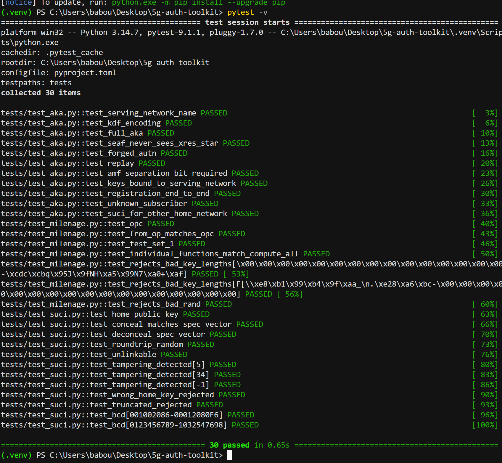

## Normal registration

When I run `5g-auth simulate`, the program creates a home network, a serving network and one phone with a SIM card, and then logs the phone in. Each line in the output is one of the parties doing one step. The colours just make it easier to see who is doing what.

Here's what happens, line by line:

1. **UE** (the phone) encrypts its ID and sends it as a SUCI. The start of the string, `242-01`, is still readable because the network needs it to know which operator to ask (242 is Norway). The long hex part after it is the encrypted subscriber number.
2. **SIDF** (my operator) is the only one with the private key, so it decrypts the SUCI and finds out which customer this is.
3. **AUSF** (my operator) runs MILENAGE with that customer's secret key and creates a challenge. SQN=1 is a counter that goes up by one every login.
4. **SEAF** (the network I'm connected to) passes the challenge on to the phone, together with its own network name.
5. **UE** checks the challenge. If the code inside it is right, the challenge must have come from my real operator, because nobody else has the key. It also checks that the counter is new. Both are fine, so it sends back an answer, RES\*.
6. **SEAF** does a quick check of the answer. It only has a hashed version of the right answer, so it can check without actually knowing it.
7. **AUSF** does the final check against the real answer and hands over the session key, KSEAF.
8. **SEAF** confirms the login. At this point the phone and the network have the same key, and that key was never sent over the network.

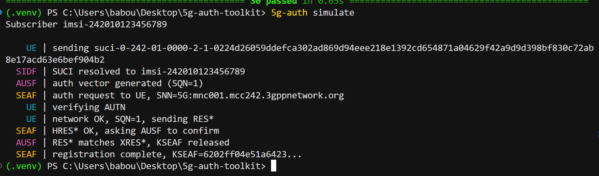

## Attack scenarios

I built in four attacks that you can run with `5g-auth simulate --attack <name>`. Each run first does one normal login, so you can see what normal looks like, and then tries the attack. All four were blocked, and each one by a different part of the protocol. That's the point I wanted to show: every check in 5G is there to stop something specific.

| Attack | What the attacker does | Blocked by | Error |
| --- | --- | --- | --- |
| `replay` | Records a real RAND/AUTN and sends it to the phone again | Phone sees an SQN it has already used | `SYNCH_FAILURE` |
| `fake-network` | Fake base station without K sends random RAND/AUTN | MAC in AUTN can't be made without K | `MAC_FAILURE` |
| `tamper-suci` | Flips one bit in the encrypted part of the SUCI | HMAC tag in the SUCI no longer matches | `SUCI_INVALID` |
| `wrong-network` | Rogue network reuses a challenge made for another network name | RES\* is tied to the network name, so the home network rejects it | `RES_MISMATCH` |

### Replay

Here the attacker listens in, copies a real challenge from the network, and sends it to the phone again later. The challenge itself is genuine, so the code inside it is valid. What gives it away is the counter: the phone already accepted SQN=2 a moment ago, and it only accepts numbers it hasn't seen before. So the copy is refused with `SYNCH_FAILURE`.

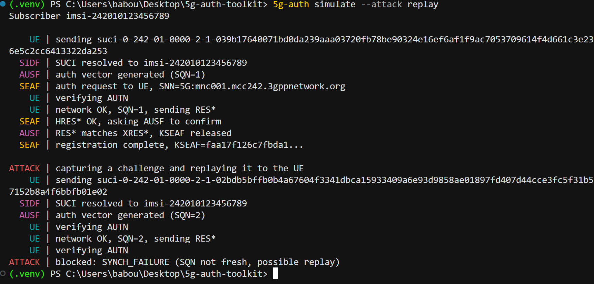

### Fake base station

This is what an IMSI catcher or fake cell tower would try. It can pretend to be a network, but it doesn't know the secret key in the SIM card. That means the best it can do is send random data. The phone calculates what the code should be, sees that it doesn't match, and refuses to answer (`MAC_FAILURE`). In 2G this check didn't exist, which is why fake base stations used to work so well.

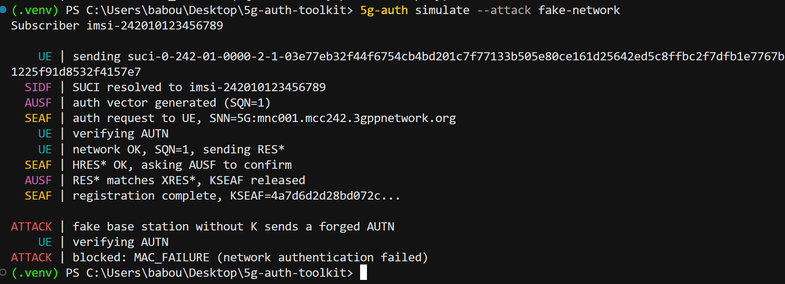

### Tampered SUCI

Here the attacker changes a single bit in the encrypted ID on its way to the home network. Without the key they can't read it, but they could try to mess it up. The SUCI includes a tag (like a checksum that needs the key to make), and the home network checks that tag before it decrypts anything. One flipped bit and the tag no longer matches, so it's refused with `SUCI_INVALID`.

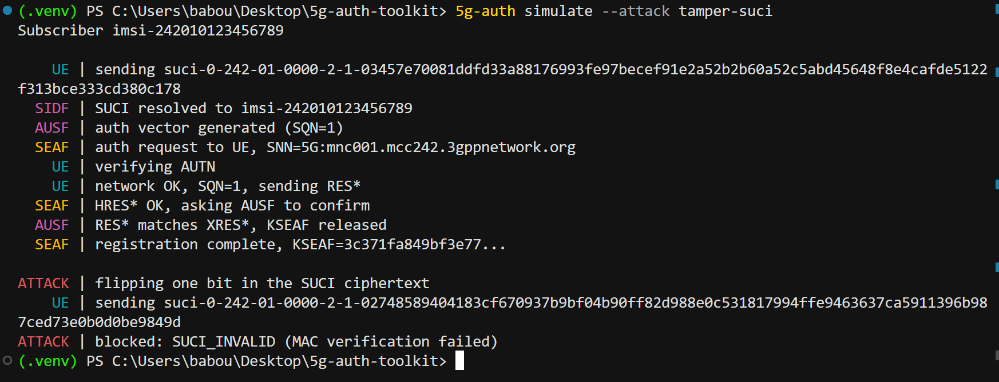

### Wrong serving network

This one is the most interesting to me. A dishonest network takes a challenge that was made for another network and uses it under its own name. The phone actually accepts it, because the challenge really did come from the home network. But the phone's answer, RES\*, is calculated with the network name inside it. When the answer reaches the home network, it was made for the wrong name, so it doesn't match and the login fails with `RES_MISMATCH`. This is why 5G lets the home network make the final decision, not the network you're connected to.

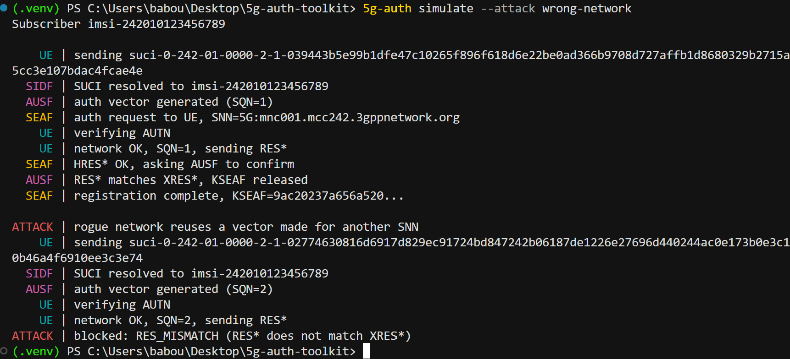

## Break-it tests

Green tests only show that the code works when everything is right. To prove that each security check actually matters, I break the code on purpose and check that the right test catches it. If I remove a check and nothing turns red, the check is either useless or my tests are missing something.

### 1. Removing the replay check

I commented out the two lines in `aka.py` that compare the new SQN with the highest one the SIM has seen before:

```python
sqn_int = int.from_bytes(sqn, "big")
# if sqn_int <= highest_sqn:
#     raise AuthError("SYNCH_FAILURE", "SQN not fresh, possible replay")
```

**Result: 1 failed, 29 passed.** Only `test_replay` failed, and the other 29 stayed green. That tells me those two lines are the only thing in the whole project that stops a replay. Nothing else catches it by accident.

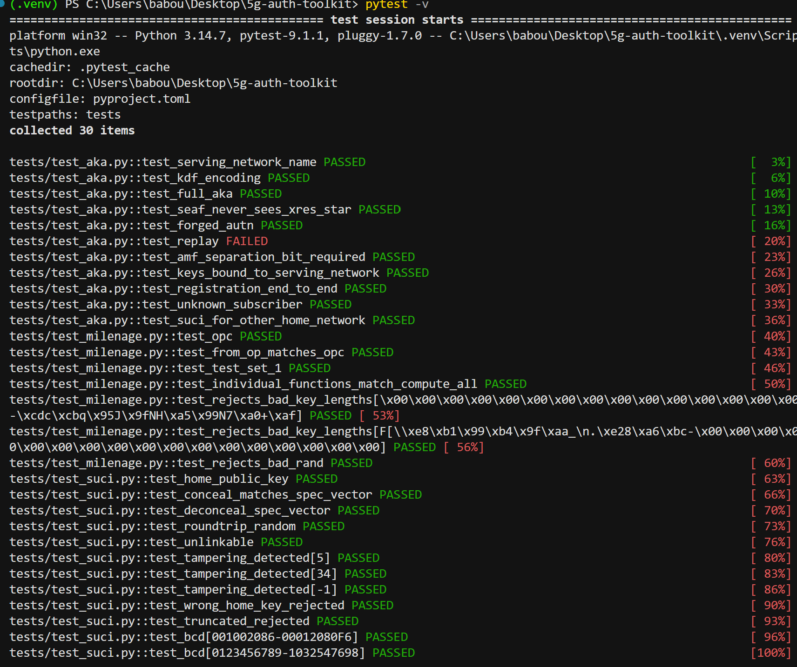

The error says `DID NOT RAISE AuthError`. The test sends the same challenge twice and expects the phone to refuse the second one, but the phone just accepted it.

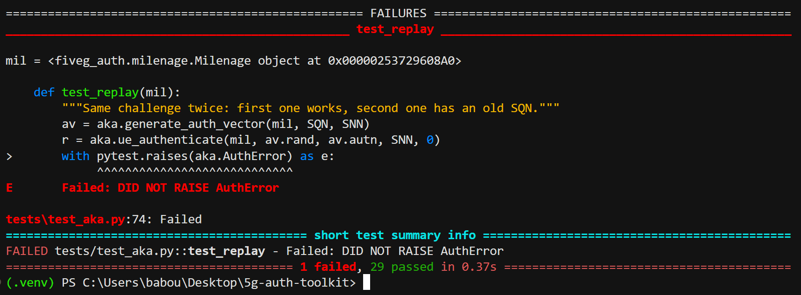

In the simulator the difference is easy to see. The phone says "network OK, SQN=2" twice for the exact same challenge, and the last line is `ATTACK | NOT blocked`. Compare this with the replay screenshot in the attack section, where the second attempt was stopped with `SYNCH_FAILURE`. In a real network this would let an attacker reuse an old challenge to make a phone log in again.

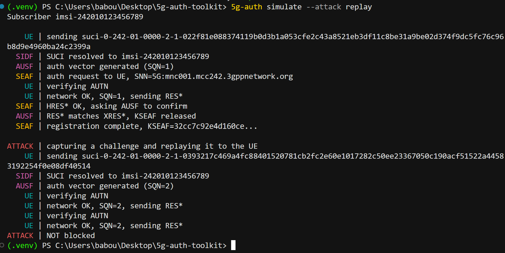

After this I put the two lines back and ran `pytest` again to make sure everything was green.

### 2. One wrong number in MILENAGE

This time I changed one rotation value in `milenage.py`. `_R3` decides how far the data is rotated inside f3, the function that makes the cipher key CK. I changed it from 4 to 5, which is the kind of small typo that's easy to make when copying numbers from a spec:

```python
_R1, _R2, _R3, _R4, _R5 = 8, 0, 5, 8, 12   # _R3 should be 4
```

**Result: 1 failed, 29 passed.** I expected a lot of tests to fail, since every other part of the project builds on MILENAGE. But only `test_test_set_1` failed.

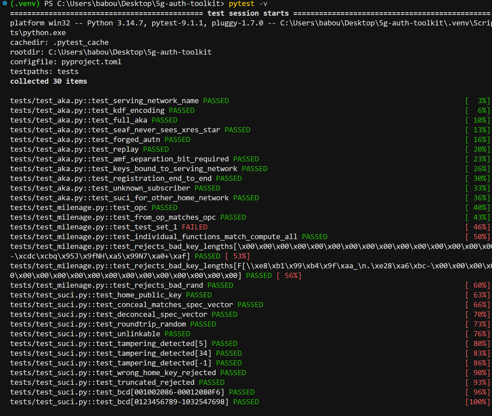

The failure shows exactly where it went wrong. f1 and f2 still match the spec, but f3 (CK) is completely different from the official value. The red line is what the spec says it should be, and the green line is what my broken code gave.

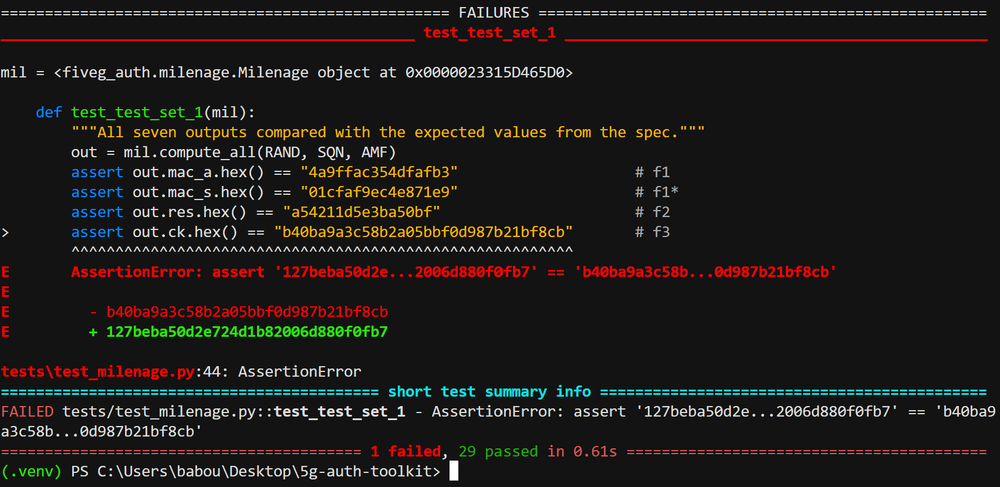

**Why only one test caught it:** the phone and the network both use the same `milenage.py`. When f3 is wrong, it's wrong on both sides in exactly the same way, so they still agree with each other. The login works, the keys match, and all the round-trip tests are happy. The only thing that notices is the test vector from 3GPP, because it compares with the official answer instead of with my own code.

In real life this would be a serious bug. My simulator would look fine, but it could never talk to a real SIM card or a real network. This is the clearest example I have of why test vectors matter so much in cryptography: a system can be consistent with itself and still be wrong.

After this I changed `_R3` back to 4 and ran `pytest` again to make sure all 30 passed.

### 3. Wrong tag length in SUCI

The last test was in `suci.py`. A SUCI ends with a tag that proves nobody changed it on the way. The 3GPP standard says this tag is 8 bytes. I changed it to 16:

```python
MAC_LEN = 16   # should be 8
```

**Result: 2 failed, 28 passed.** Both failures are the official 3GPP example, one in each direction.

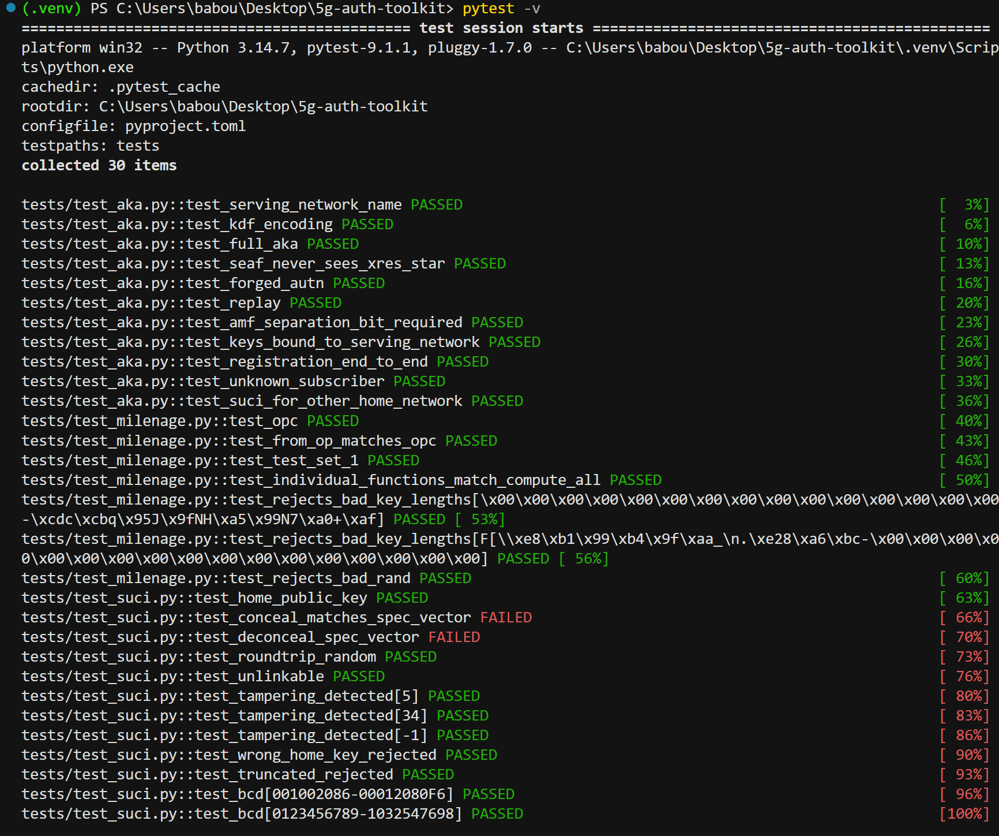

The two errors show the problem from both sides:

- **Encrypting** (`test_conceal_matches_spec_vector`): my SUCI came out 8 bytes too long. In the diff, everything up to the tag matches the spec exactly, and then my version just keeps going (the green part marked with `+`). Even the first 8 bytes of the tag are the same, because it's the same HMAC, just cut at a different length.
- **Decrypting** (`test_deconceal_spec_vector`): the official SUCI is 46 bytes (33 key + 5 ciphertext + 8 tag). With a 16-byte tag, the code needs at least 50 bytes, so it stops right away with `scheme output too short`.

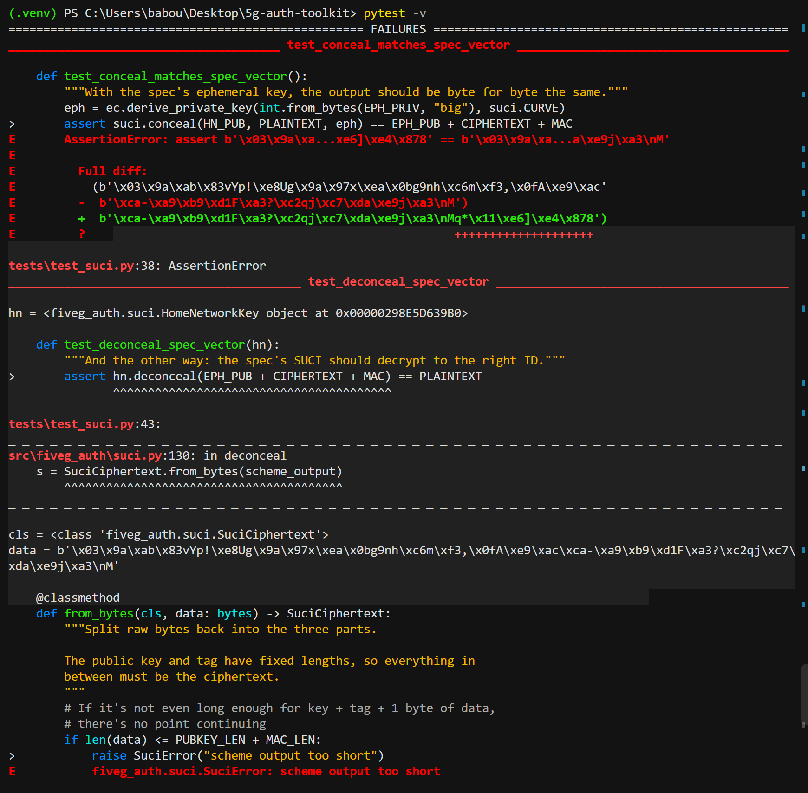

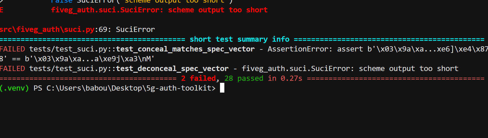

This is the same lesson as the MILENAGE test. All the other SUCI tests still passed: round trip, unlinkability, tampering and wrong key. They passed because my phone and my home network both used 16 bytes, so they understood each other fine. But a real phone sends 8 bytes, and my home network would have rejected every single one of them. Again, only the official test vector caught it.

After this I changed `MAC_LEN` back to 8 and ran `pytest` again.

## Publishing to GitHub

The project is now in a private GitHub repo: `BaboucarrKah/5G-Auth-Toolkit`. Putting it on GitHub means the code is backed up somewhere other than my desktop, and GitHub runs all the tests automatically every time I push a change (that's the CI file in `.github/workflows`).

Before pushing I ran `ruff check .`, the same style check GitHub runs, and it passed. Then I created the repo on GitHub as private with no files, and connected my local folder to it.

After `git add .` I checked `git status` to see exactly what would be uploaded. It listed 15 files: the code, tests, README, license and CI setup. The important part is that `.venv` is not in the list, so `.gitignore` works and my local Python environment stays on my PC. The yellow LF/CRLF warnings just mean Windows and Linux end lines differently, and Git handles that for you.

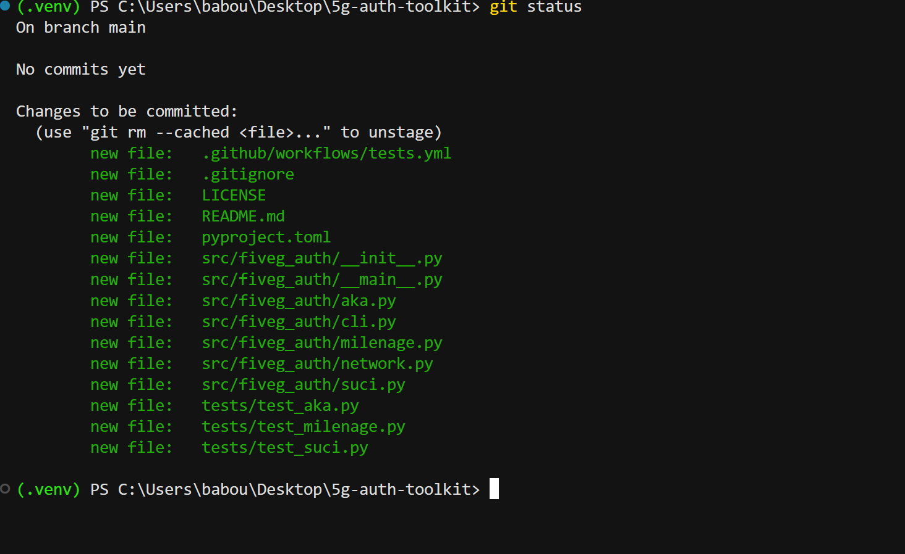

The first push failed with `Invalid username or token`. GitHub stopped accepting normal passwords for Git in 2021, and my Git had no sign-in helper set up, so it had no way to open the browser login.

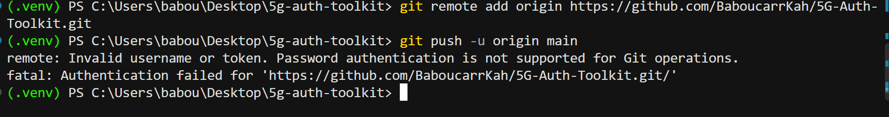

I fixed it with `git config --global credential.helper manager`. On the next push Git opened the browser, I signed in to GitHub, and all 22 objects were uploaded. From now on `git push` works without logging in again.

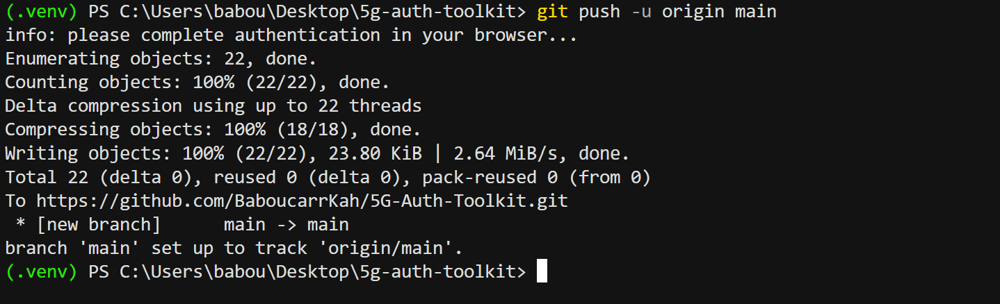

After that I added `docs/SECURITY_TESTS.md`, a clean write-up of the attack scenarios and break-it tests for the repo, and linked it from the README. Both pushes started a CI run on GitHub, and both passed: GitHub installed the project on a fresh Linux machine, ran ruff, all 30 tests on Python 3.11, 3.12 and 3.13, and every attack scenario. So the project doesn't only work on my PC.

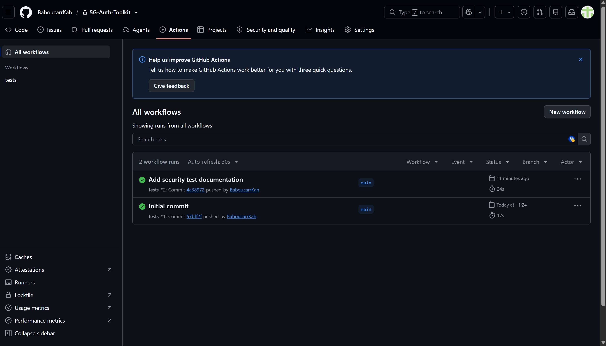

The repo was private at first, because the MILENAGE part does the same thing as a course assignment. I made it public once the assignment had been approved.

## What I noticed

- **The SUCI is different every time.** If you compare the screenshots, the same subscriber sends a completely different encrypted string in every run. That's because the phone makes a brand new key pair for each SUCI. So someone listening can't even tell that two logins came from the same phone, which is exactly what stops tracking.
- **The key is never sent.** Both sides end up with the same session key, but it never travels over the network. Each side calculates it on its own from the shared secret and the challenge.
- **No single check does everything.** Each attack was stopped by a different mechanism: the counter, the code in the challenge, the tag on the SUCI and the network name. If you removed any one of them, one of the attacks would get through. The break-it tests above prove this for the replay check.
- **Working together is not the same as being correct.** In two of the three break-it tests, the phone and the network still logged in fine, because they made the exact same mistake. Only the official 3GPP test vectors noticed. Without them I would never have known the code was wrong.

## Next tests

- [x] Rename the two byte-named tests (`ids=["short-k", "long-opc"]`)
- [x] Break-it: comment out the SQN check in `aka.py`, confirm `test_replay` fails and `--attack replay` says NOT blocked
- [x] Break-it: change `_R3` from 4 to 5 in `milenage.py`, confirm the f3 test vector fails
- [x] Break-it: change `MAC_LEN` from 8 to 16 in `suci.py`, confirm the spec vector fails
- [ ] Set up the VS Code Testing panel
- [x] Check that the first CI run on GitHub (Actions tab) goes green
- [x] Make the repo public once the BTS4410 assignment was approved

---

The next part, adding security logging and detecting these attacks in Splunk, is in [5g-detection-lab](https://github.com/BaboucarrKah/5g-detection-lab/blob/main/docs/SOC_LOG.md).
